How we managed to clinch first place in the hackathon by creating a solution for the ZALORA problem statement with the use of AWS technologies.

## About this Project 

:::figure
::youtube{id="Cq3ufhtkiLg" title="YouTube video" query="si=LSX-gs1AsZvAGP-F"}

Watch the youtube video for the full demonstration and an explanation on the architecture. (I apologize for the rushed speech, it was filmed on the same day and my adrenaline was PUMPING)
:::

The AWS Build On Hackathon 2022 Challenge was the first hackathon I took part in. Like many hackathons, the goal of the challenge was to solve problem statements given using AWS Technologies.

## The Problem

:::figure
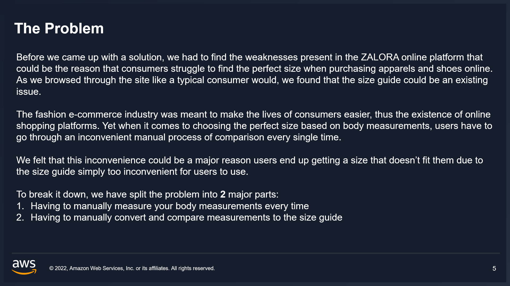

A summary of the problems identified
:::

There were two problem statements provided this year, but one my team selected was the problem statement given by ZALORA: 
> Develop a solution that provides ZALORA's diverse range of shoppers with the confidence that they are selecting the right size when shopping online.

Through our research and exploration into ZALORA’s online store, we narrowed down the problems into two main ones. 

Users have to manually measure their body measurements every time, and have to manually convert and compare measurements to the size guide. So our team came up with a simple yet effective solution that can easily be solved with the help of AWS technologies. 

## The Proposed Solution

:::figure
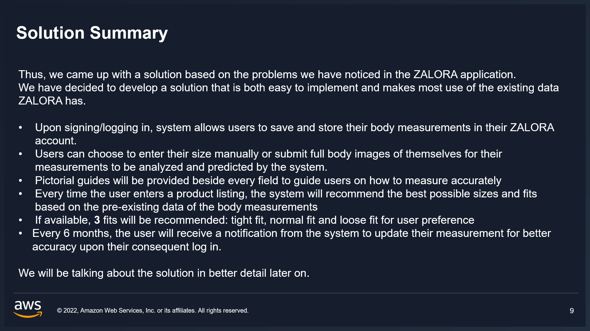

A quick summary of our proposed solution
:::

We proposed for the solution to be broken down into different phases, but the main features allows the saving of requirements, giving users the ability to upload a full body image for the system to predict body measurements as well as recommend different available fits to users based on saved measurements. The side features are included to make sure that users will be keeping the information updated for accuracy.

## But..how does ZALORA benefit?
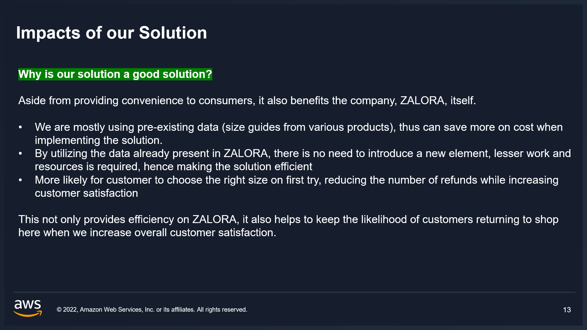
 Well, our solution can start out simple by estimating measurements to size guides with just code (AWS Lambda) based on user input before measuring its impact and pushing out more advanced features to customers gradually. ZALORA is a site that allows users to shop multiple brands in one place, and allowing customers to store measurements and compare the same data to multiple e-commerce brands at one go, saves time and improves the site’s retention rate. Convenience is a huge part of e-commerce but a huge trade off is the clothes not fitting right. So having a system for just storing and converting measurements can bring so much value for both customers and companies. **Simple, yet effective.**

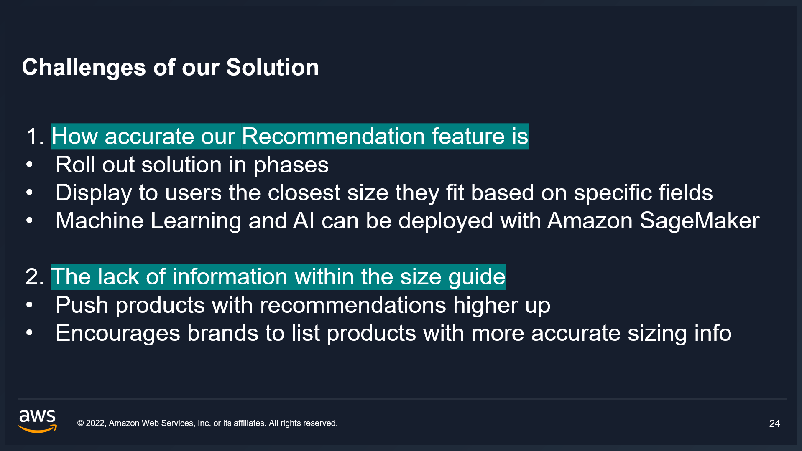
However, the solution is not entirely foolproof. Many listings in ZALORA can have a severe lack of information on their size guides, and without that information our solution will be obsolete if it doesn't apply to all/ every product. 

Through our research, it shows that the sizing information on listings of brands not listed correctly are actually available on their official sites. So it was not about a lack of data, but vendors not uploading fully accurate information into ZALORA. So we proposed a workaround to this problem: by pushing brands with accurate sizing info much higher up.

In summary, our solution solves a simple issue with a simple solution in ZALORA. It is an effective solution in solving the given problem statement, being **cost effective** and **easy to deploy**, while it is also **scalable** with the help of AWS technologies.

## Roles and Contributions
**Team Lead, Solution Architect, Solution Prototype Creator**

I started off with the idea of joining this project alone, but eventually approached a close friend of mine Yo Ming for assistance as the deadline to the proposal submission was rather short. Being the team lead, I directed the team from research to prototype and finally the presentation. As the only member of the team familiar with the AWS cloud technologies, I handled the architecture and prototype of the solution alone with some help and mentorship from my lecturers back in Ngee Ann: Ms Siew Siew Ong and Mr Wesley Teo.

## My Take on this Project
Overall, I am extremely proud of the results created from the effort my team has put into this hackathon. Although like I mentioned in the video, the architecture of the solution could be improved based on some feedback given by the panel. But I feel that our team managed to create a well rounded solution that hit many good points, identified potential issues and listed their workarounds. 

Based on the QnA and feedback given by the panel right after the presentation was given, I would say that our team did a pretty great job as we managed to answer all of the panel’s questions. I’m proud of our achievement as a team with us both joining a hackathon for the first time. This also wouldn’t have been possible without the help of my teammate, Yo Ming.

End.

## Achievements
Champion (Tertiary Category, ZALORA)

## Special Thanks
**Team ChickenRice**
: Lai Yo Ming

**Mentors**
: Mr Wesley Teo, Ms Siew Siew Ong

## Links
[Devpost](https://devpost.com/software/aws-build-on-challenge-2022)

## Gallery

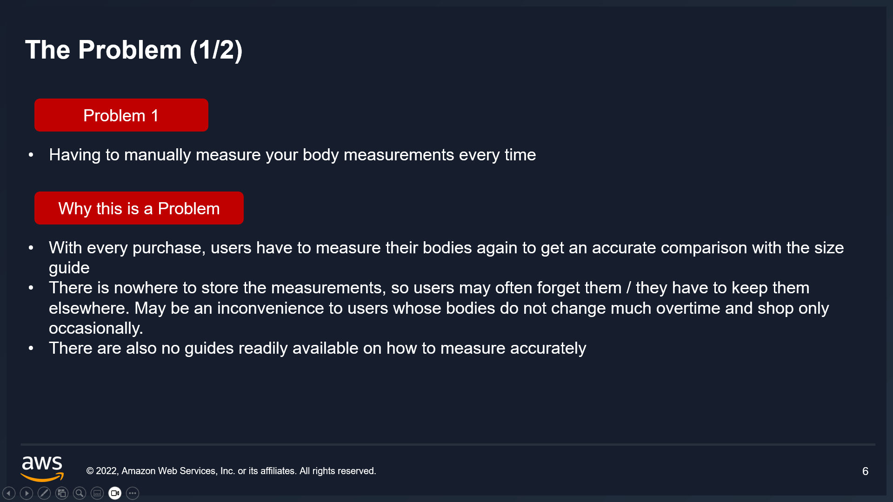

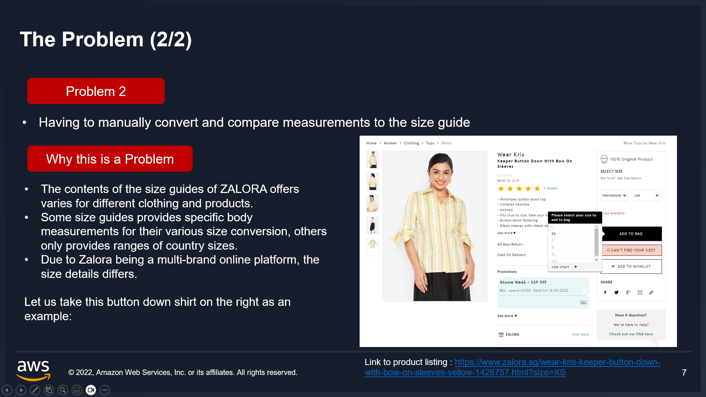

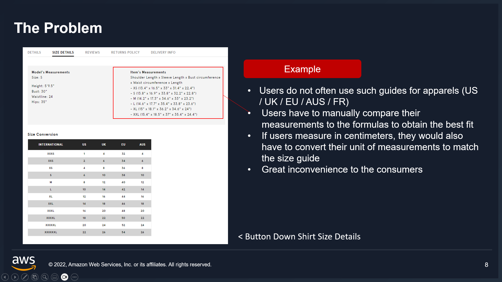

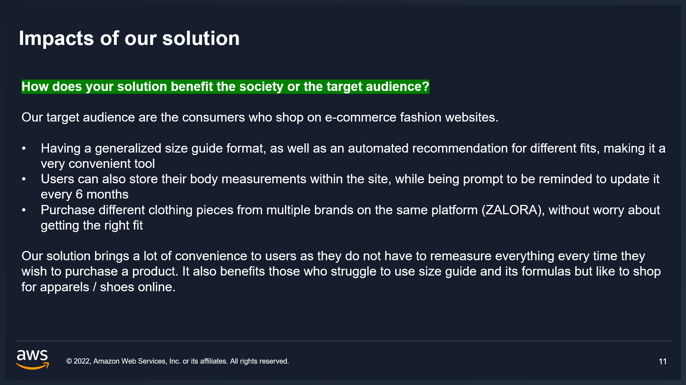

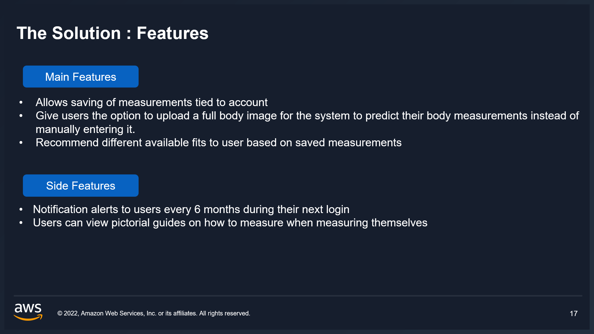

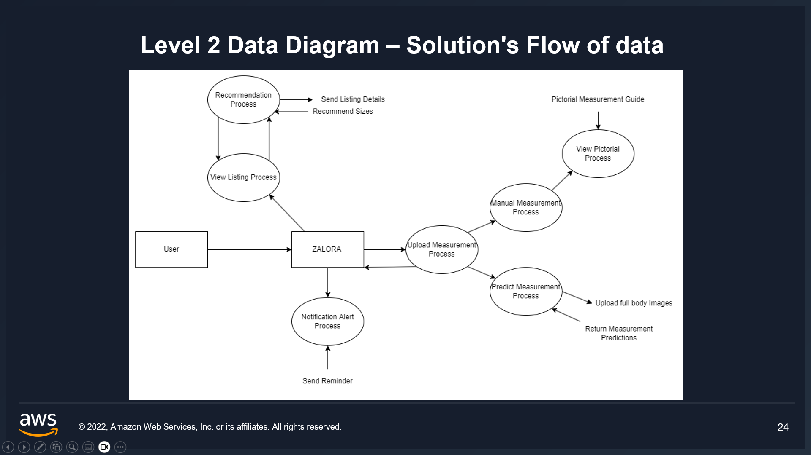

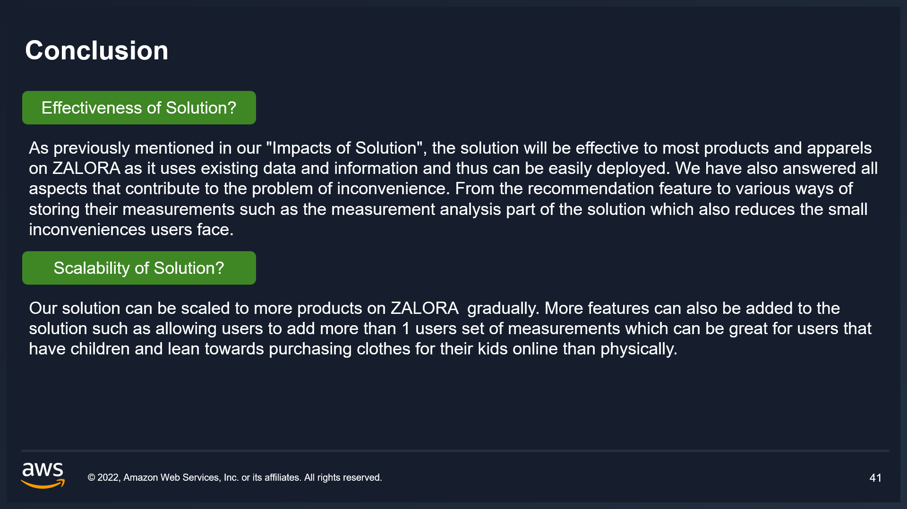
