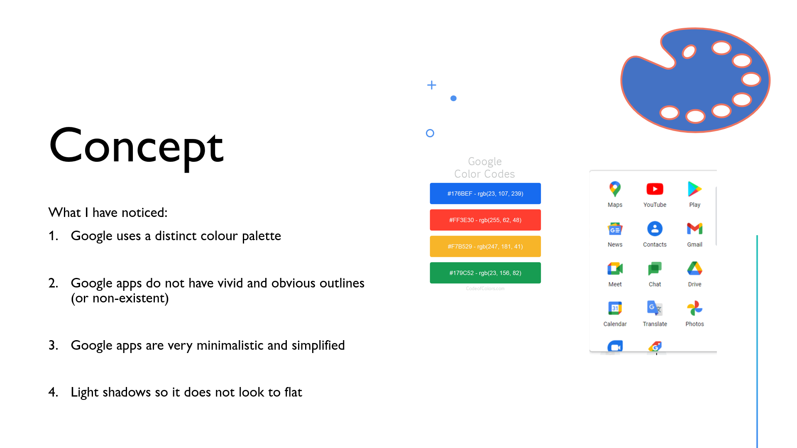
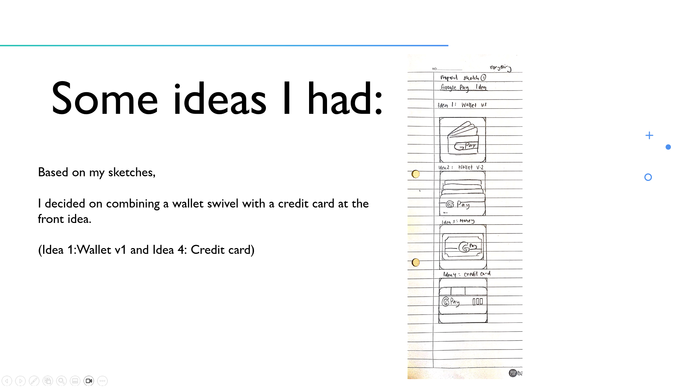
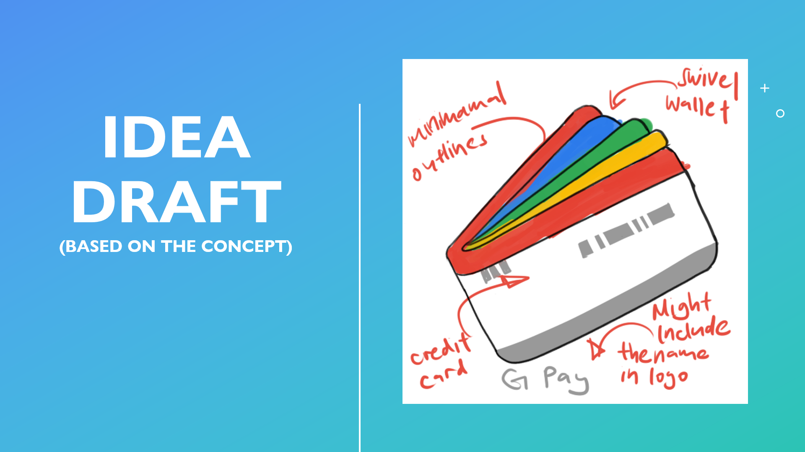
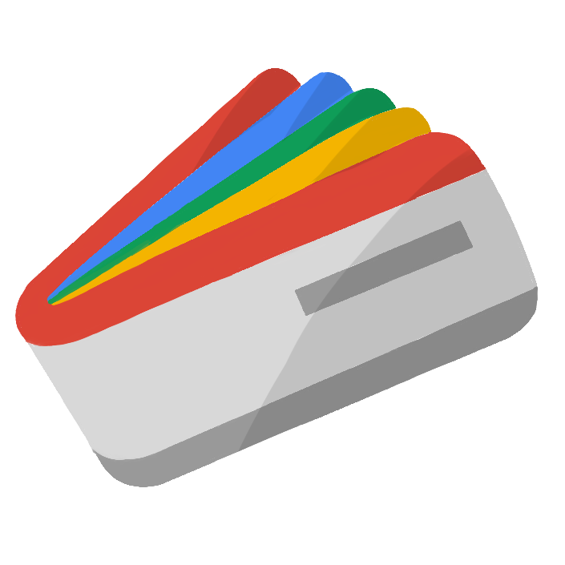
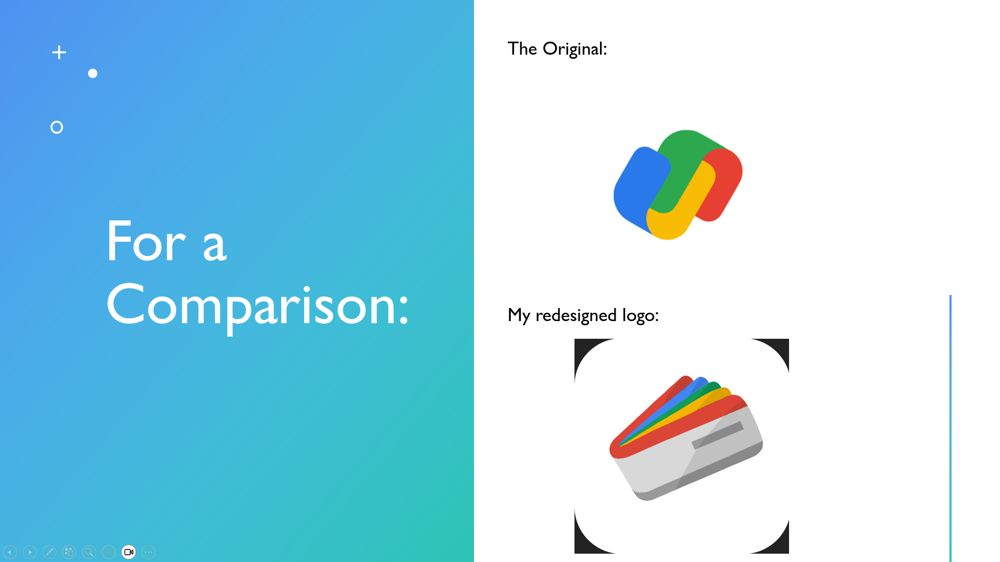

For my module in Design Principles, I redesigned the logo of Google Pay. In here, I document about more about my thought and design process behind the final product.

## About this Project
This project was an assignment given in Year 1 Semester 1 for the project Design Principles. For this assignment, we were tasked with the goal of redesigning a logo. Thus I set out to do my research on logos that I felt were vague and could be better, eventually settling on Google Pay as I felt that the logo was a little too ambiguous and could convey a stronger meaning while fitting it within the google app ecosystem.

To recreate the ‘Google’ look, I first had to identify what features google application logos have that makes them look GOOGLE. 

:::figure

A study on what makes google logos distinct
:::

Based on what I have studied, they all embody the following characteristics: a simplistic design, follows the same Google colour palette, no vivid outlines and light shadows to convey some level of depth. So using these key features I drafted different ideas around the idea of a ‘wallet’ and added some details to the final draft before going into Adobe Illustrator to create the final product.

:::figure

My first draft on ideal concepts, brainstorming stage
:::

Finally, with Adobe Illustrator I designed the Google Pay Logo to one that resembled more of a wallet with some accents to depict a credit card in front while keeping the same characteristics of Google apps, so it looks just like an originally created.

:::figure

My final concept draft of the Google Pay logo
:::

:::figure

My final result
:::

## Roles and Contributions
For this project I handled all processes myself from ideation to research and final product.

## My Take on this Project
When I finished the project, I was quite proud of the final result as it was exactly what I had envisioned it to look like from the beginning.

The wallet swivel look and the credit card in the front. I was also really pleased with the grade I received. However, looking back at it I somewhat understood more of the original Google Pay Logo with the Google colours more prominent in them. While my design contained a lot more neutral shades of grey and contained more details with its ‘flaps’, that reduced some of its impact as a ‘Google’ logo. Although my logo did contain less ambiguity on its purpose and meaning, its visual impact has also reduced in exchange.

All in all, this was a fantastic assignment introducing me to Adobe Illustrator and an eye opening experience to how logos are designed and the amount of thought that goes behind them.

## Achievements
Grade: AD (Distinction)
