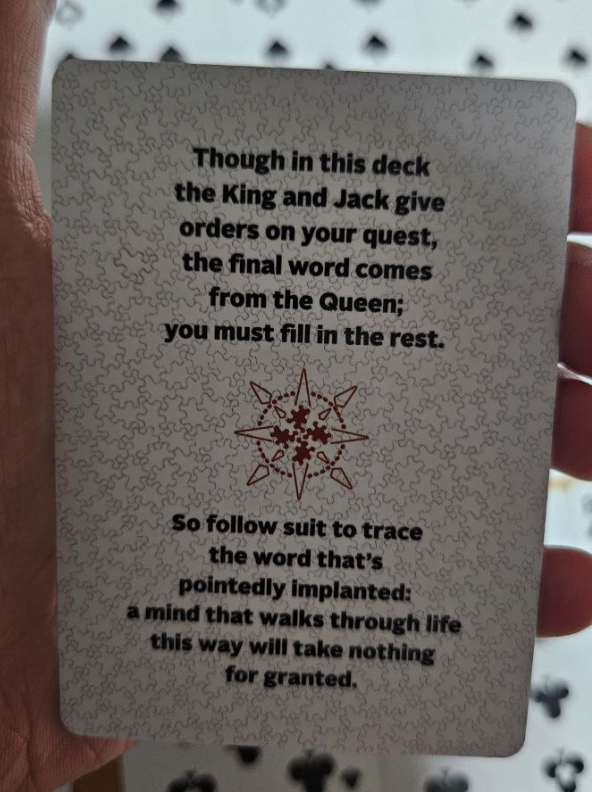
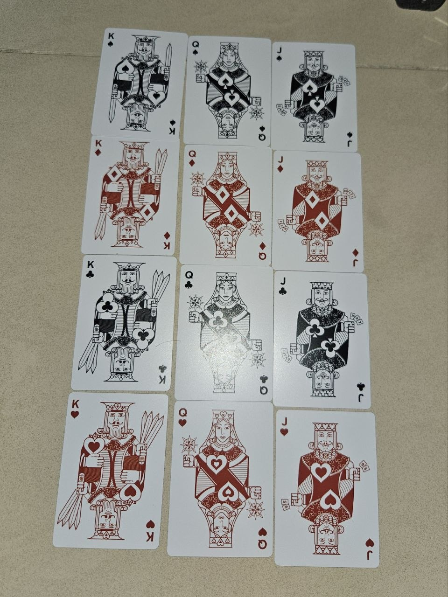
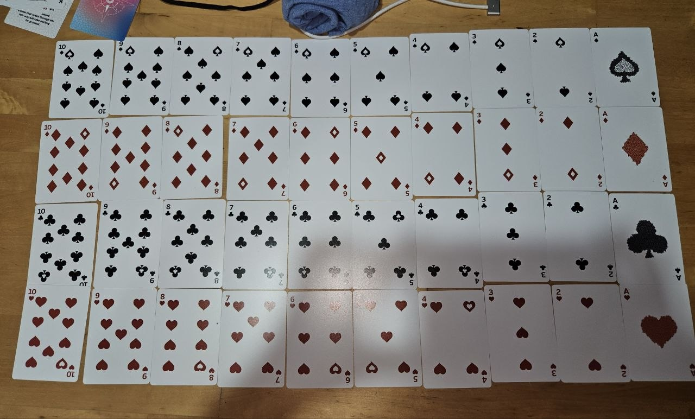
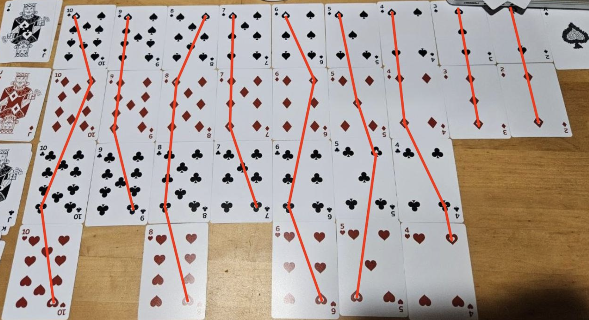
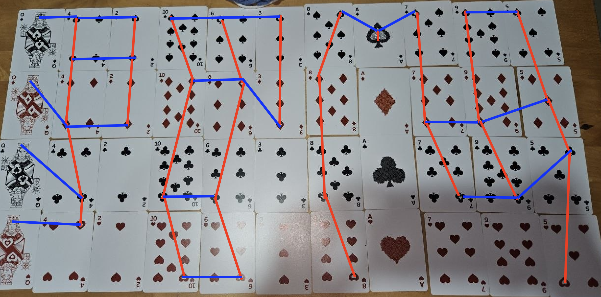
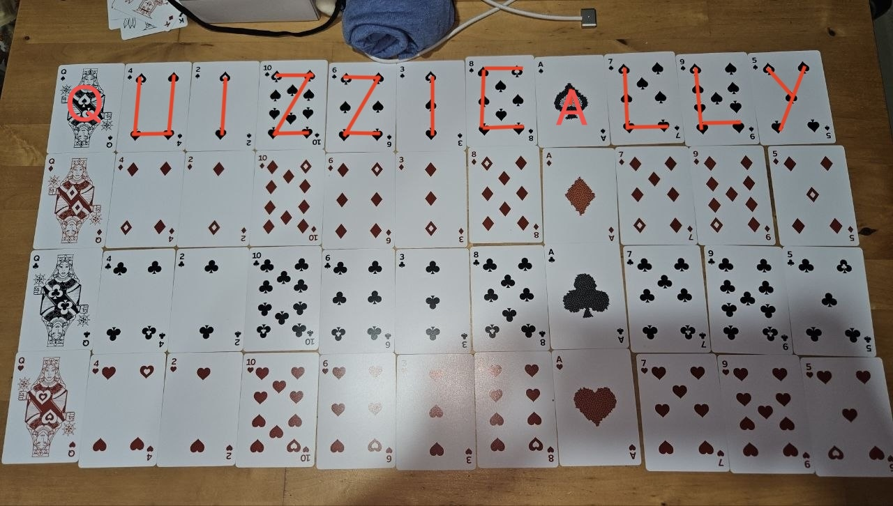
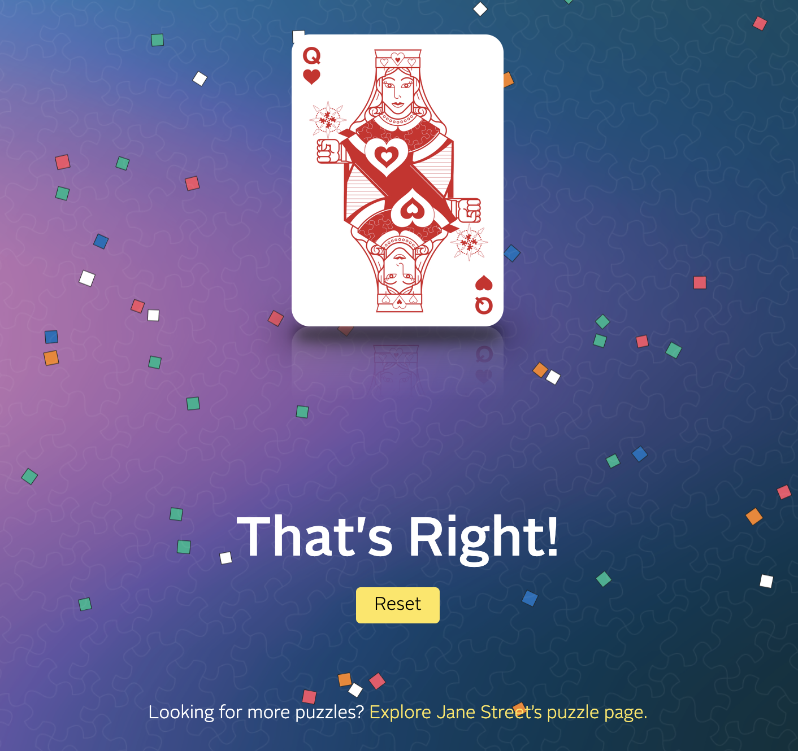

Today was my schools career fair and I stopped by a couple of booths to collect the swag one of the booth's being Jane Street. I managed to swipe their playing cards, Edition 4 in the beautifully pink and blue hue and when I opened it, I realized there was a puzzle inside. *Ooo Mysterious~*

## The Puzzle

The deck had a riddle card that said the following 

:::figure

The riddle card
:::

and it the rest of cards are as such :

:::figure

King Jack Queens
:::

:::figure

The rest of the cards
:::

Also a card with the [QR code](https://www.janestreet.com/playing-cards/puzzle-deck-edition-iv/) to put in your submission.

This is all the information u need to solve the puzzle, it took me 5.5hours to figure out and I think it was pretty hard but the riddle card was a huge help. Ahead are spoilers so if you want to solve this puzzle on your own, do not scroll further.

:::caution
SPOILERS AHEAD!
:::

## How I solved the puzzle

Initially when I begun I was quite lost on where to begin that I started laying the cards out and I quickly noticed that the Kings should be ordered in the order of the swords : **Spades -> Diamonds -> Clubs -> Hearts**. Which is already ordered above. 

When u look closer you'll also notice King, Queen and Jack to be holding hollow symbols so I seperated the cards with hollow pins from non hollows.

I was quite confused here and when arranging the hollows cards, I thought they were all aligned on the top/centre of the card but I realised that I had to arrange them via the same orientation based on the compass behind pointing north.

> So follow suit to trace the word that's pointedly implanted

The riddle then mentioned to trace so I spent so long here tracing the cards arranged in rank order. I even tried tracing them horizontally since it said "follow suit".

A friend then asked me to arrange the cards in order of the jack hands: 
**Q > 4 > 2 > 10 > 6 > 3 > 8 > A > 7 > 9 > 5**
and it finally clicked! since Kings dictated the row order, Jack dictates the column order which worked in line with the riddle 

> Though in this deck the King and Jack give orders on your quest, the final word comes from the Queen; you must fiill in the rest. 

Okay now we are close I can smell it but the tracing was a problem. I went nowhere with this for hours lol. 

then the idea came to me to overlay the cards instead of laying them out and the letters could be traced across the hollow pin.

:::figure

I finally got it lol
:::

:::figure

dont be stupid like me and not scan the qr code to access this link that u can immediately send off ur answer too.
:::

That was a super fun find!
