An android application built for an assignment, **LobangCorner** aims to bring back the joy and love of sharing with its blogging and recipe features, while providing a space to promote hawker and local businesses.

## About this Project

:::figure
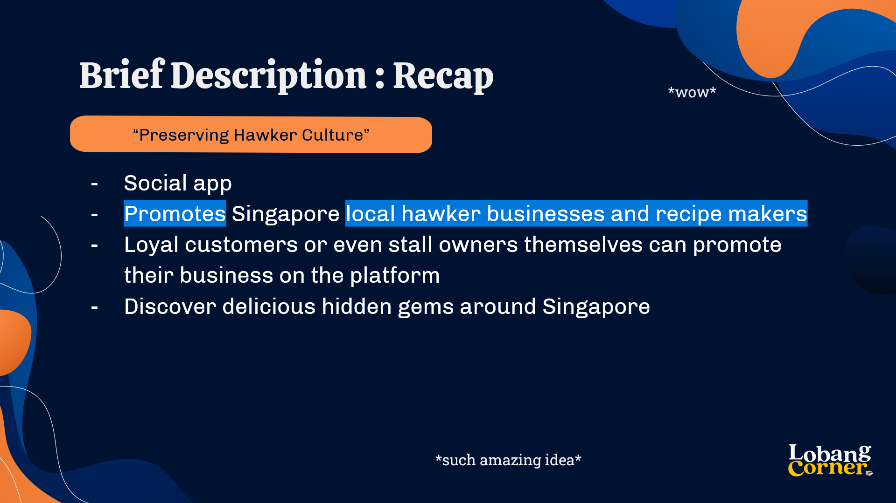

A brief description of Lobang Corner
:::

LobangCorner is a social Android Application created for the ‘Mobile Application & Development’ module in Year 2 of studying in Ngee Ann Polytechnic.

Although not a requirement in the assignment, LobangCorner was built and designed with a purpose and goal in mind. The app is a community for Singaporean food enthusiasts to share about their favourite hawker stalls and recipes. Centered around the theme of **“Preserving Hawker Culture”**, the primary goal of the app is to revive and support hawker businesses by bringing out the Singaporean spirit of sharing through its community.

### Main Features
The app consists of two main features: Hawker Corner & Recipe Corner. 

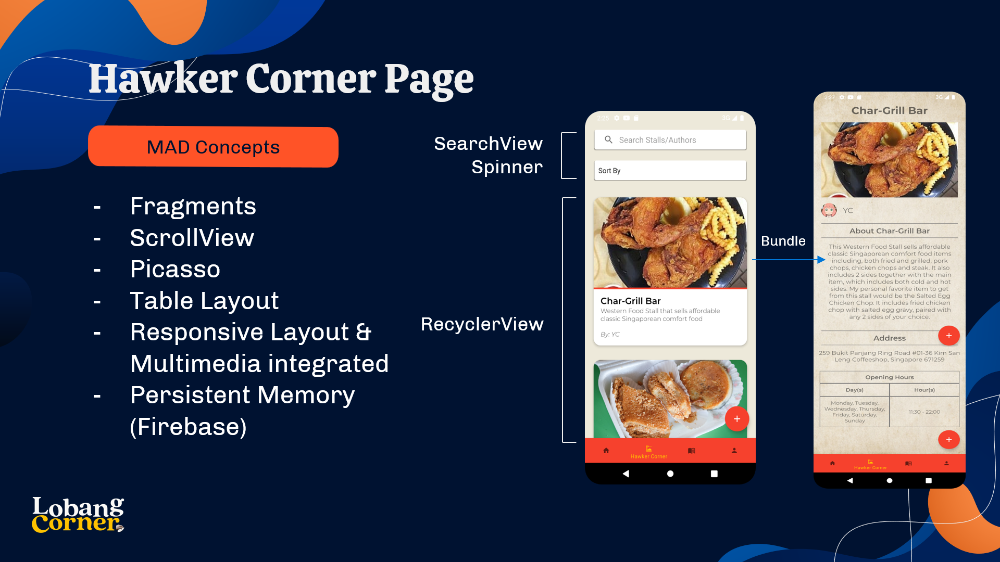
### Hawker Corner
The main focus of the application allowing both local food enthusiasts and hawkers themselves to blog about their own/favourite stalls. 

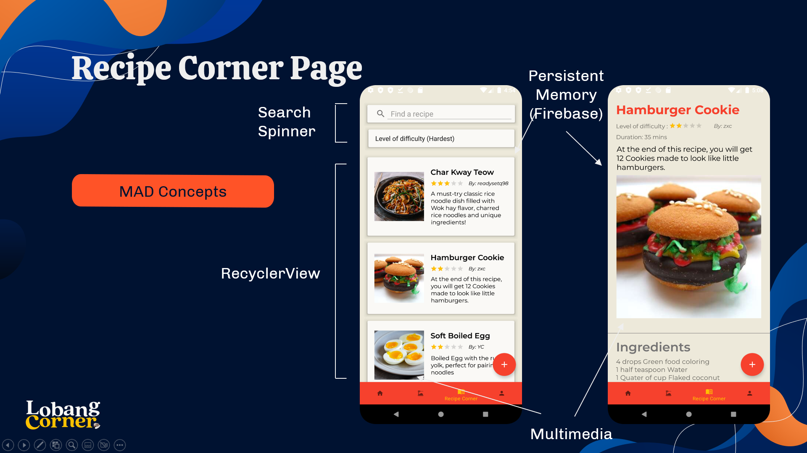
### Recipe Corner
Recipe Corner was added as a side feature for users to share their best delectable home recipes that others can replicate, to taste the flavours of different cultures and homes. (Almost like neighbours sharing their homemade food with one another!)

**In essence, the app aims to bring Singapore’s Hawker Culture back to life with its blogging features by giving a voice to local food enthusiasts, businesses and homecooks.**

## Roles and Contributions
**Team Lead, Design Lead, Home Page Developer.**

As the creator of the concept ‘LobangCorner’, I was the visionary of the team that led my team of 5 to completion of the assignment. It was my responsibility to drive us in the right direction towards the idea I had in mind of LobangCorner, such as aligning our features in the app to be in line with our eventual goal. I also overlooked the progress of the team every step of the way and arranged our weekly meetings.

:::figure

Logo variations created for LobangCorner (beige, orange and transparent backgrounds)
:::

Besides being the project lead, I also handled the overall artistic direction of the application such as designing the colour palette of the app, the UI and the creation of the logo as well. 

:::figure
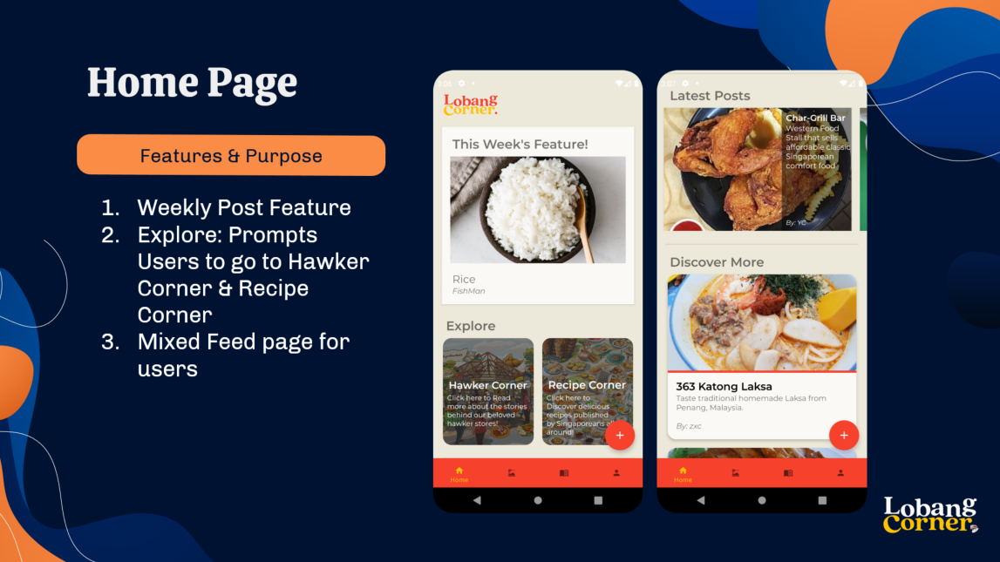

The Home page was the main page that I worked on, showcasing weekly fetaured posts and the latest uploads
:::

As a developer, I mainly handled the Home page of the application which was a challenge in the beginning, needing to apply more advanced concepts such as a nested recycler view. It is through this role and assignment that I managed to understand and apply the concept of MVC.

## My Take on this Project
LobangCorner is truly personal to me as it was the first original idea that I could implement and create.

:::figure
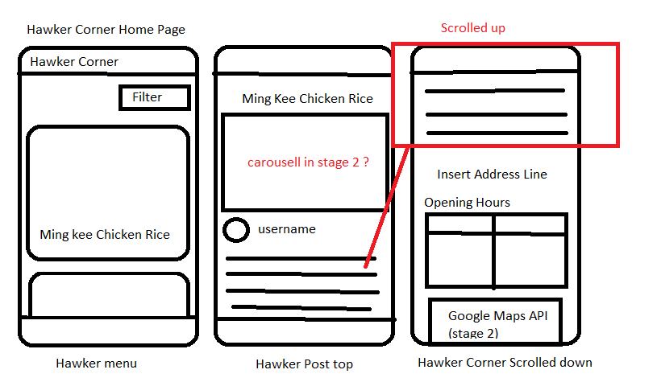

How I prototyped design guidelines the idea of HawkerCorner and RecipeCorner in the beginning. I would upload them on a powerpoint slide and share it with the team xD. (Was not the best method of disseminating information but it wasn't too bad).
:::

 Leading the team consisting of 4 other developers (besides myself) that fully trusted my vision was a privilege and an experience. It was a struggle initially as neither of us have created an android application before and our project was filled with a lot of uncertainty, I also wasn't experienced in leading software projects especially with such a big team. 
 
 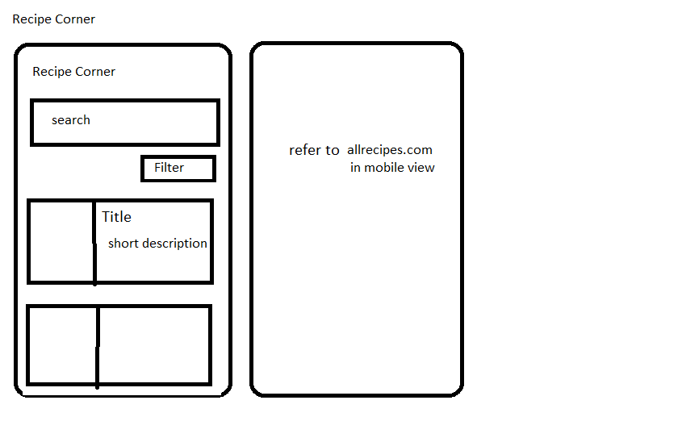
 But with my team’s trust and support we managed to overcome all obstacles and deliver a complete product. It was through their cooperation and enthusiasm that we, as a team, managed to achieve the vision that I’ve set out to accomplish from the beginning.

There are many lessons that I’ve learned over this project and one of the greatest was how crucial it is to design software structures to be scalable and flexible from the beginning. As we progressed through the timeline, the team realized that our planned approach of designing classes was very restrictive and non-standardized, making it difficult to use both classes in the same view. Although we managed to create some workarounds, this issue stressed the importance of planning before beginning which would have saved us a lot of trouble.

Nonetheless, my team and I are extremely proud of the results that we have achieved and the lessons learnt from this project in the process of creating LobangCorner. Thank you for reading.

## Achievements
Grade: A/A+

## Special Thanks
**Team Members**
: Celsius Chia, Chan Zi Xian, Lai Yong Chuen, Hasanah

**Lecturer**
: Mr Wesley Teo

**Additional Credits**
: Drew inspirations of LobangCorner from <https://ourgrandfatherstory.com/>
:  **Sharecipe** and <https://allrecipes.com/> for some of their UI Design.

::github{repo="beefwhale/LobangCorner"}

## Gallery

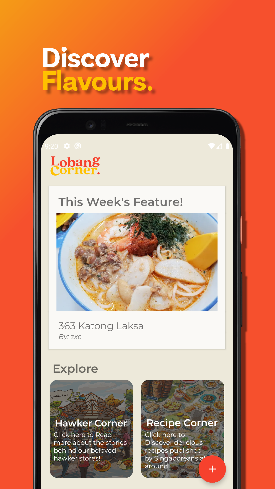

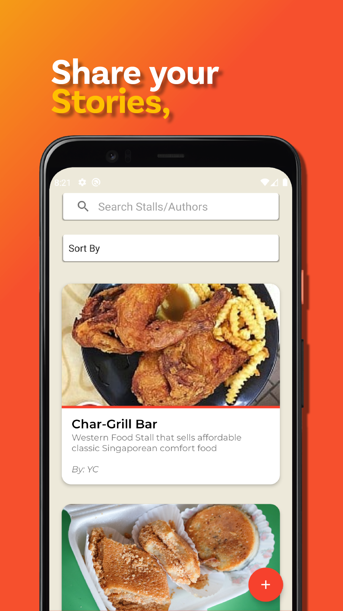

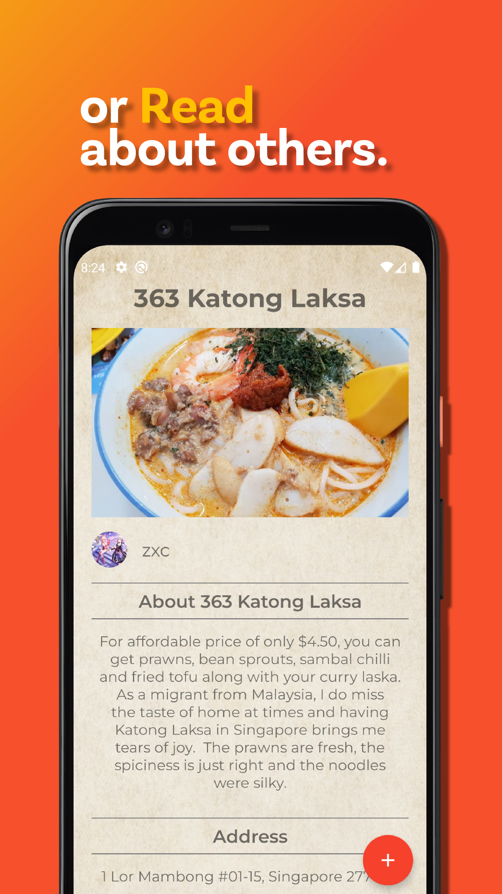

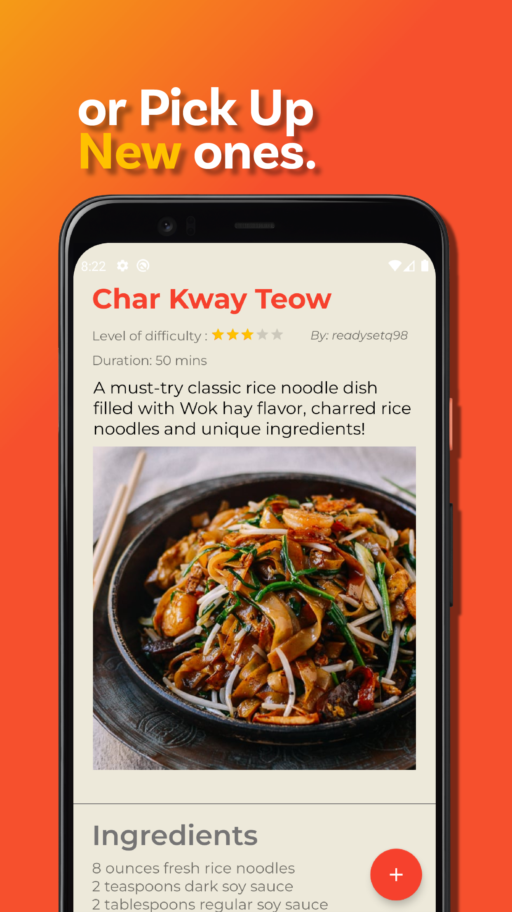

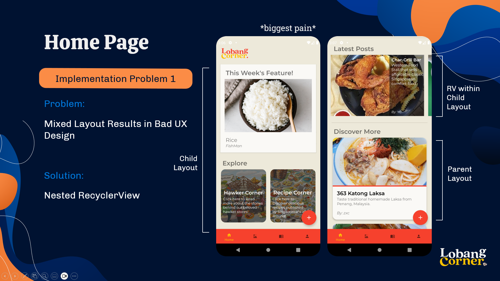

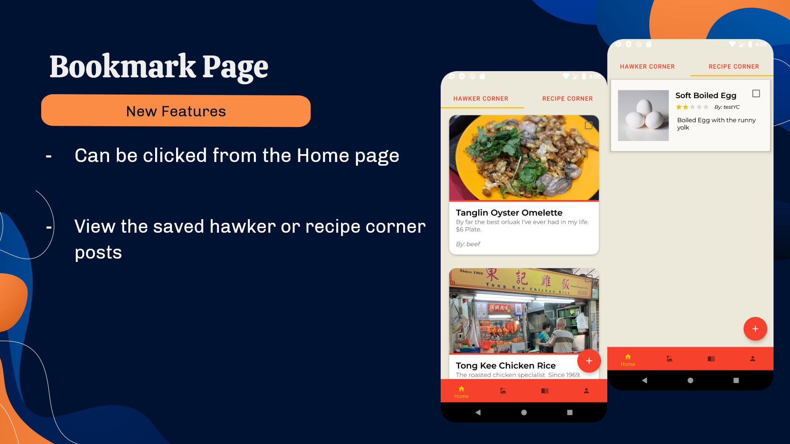

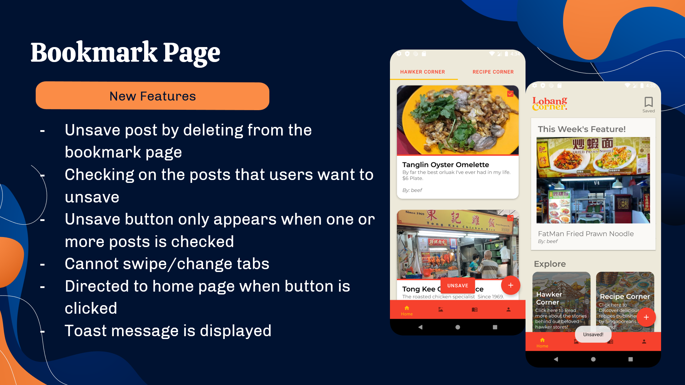

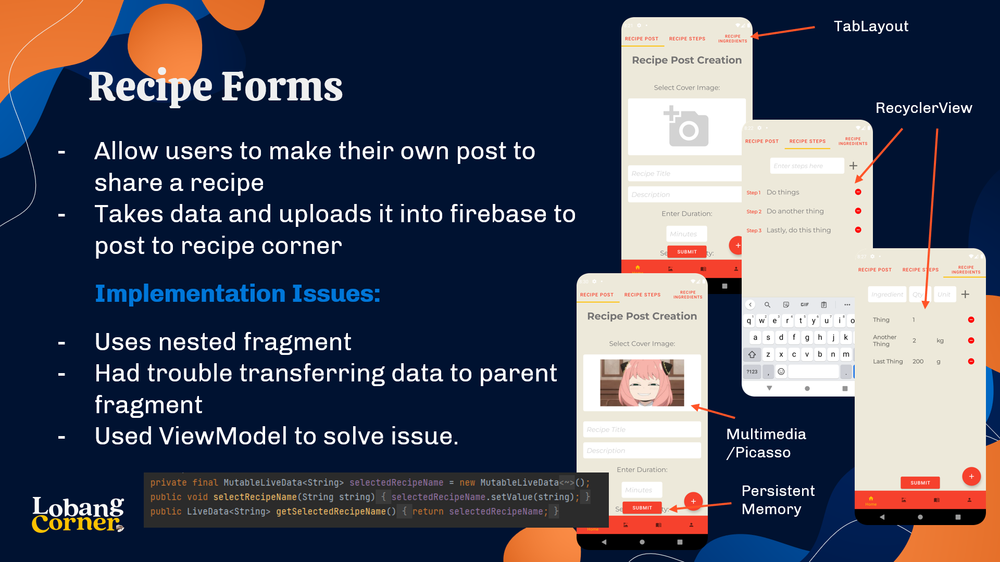

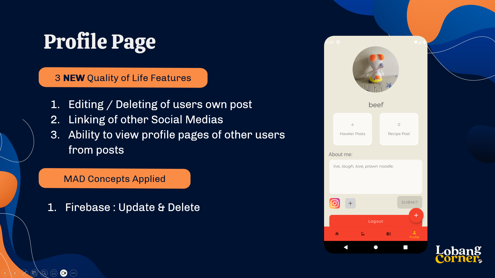

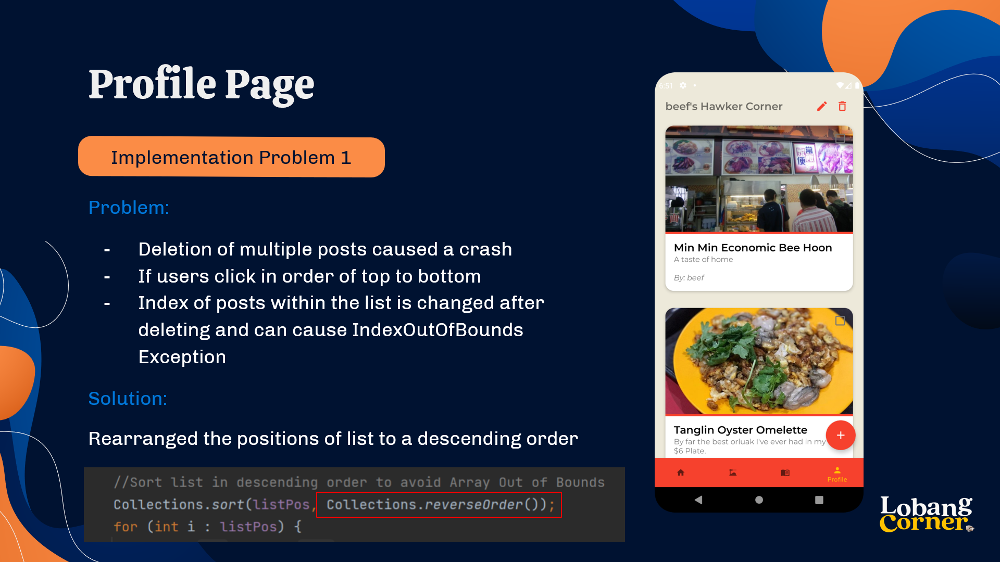

